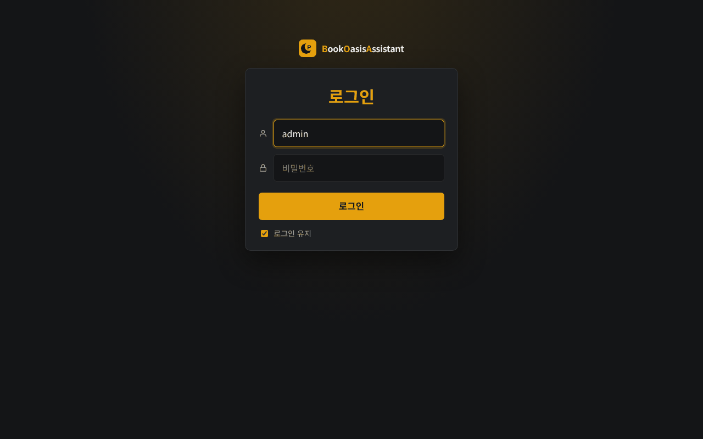

# BookOasis Assistant 설치 가이드 ② 도커 (Docker Compose)

> 이 문서만 따라 하면 설치가 끝나도록 썼습니다. 리눅스 서버 + Docker Engine + Docker Compose(v2) 기준입니다.
> 가상환경으로 설치하려면 → [install-venv.md](install-venv.md) · 설치한 뒤 화면 설정 → [setup-guide.md](setup-guide.md)

> ⚠️ **가능하면 가상환경 설치를 쓰세요.** 도커에서는 ① 웹툰 저장 경로를 **BookOasis 컨테이너와 같은 경로**로 마운트해야 하고,
> ② rclone 마운트는 `:rslave`로 전파해야 하며, ③ 컨테이너 안의 `127.0.0.1`은 호스트가 아니고, ④ 받은 파일이 root 소유가 되며,
> ⑤ 업데이트할 때마다 이미지를 다시 만들어야 합니다. 아래는 도커만 쓸 수 있는 환경을 위한 방법입니다.

---

## 0. 무엇이 설치되나

| 항목 | 호스트 | 컨테이너 안 |
|---|---|---|
| 프로그램(저장소) | `/opt/bookoasis_assistant` | `/app` |
| 설정 파일 | `/opt/bookoasis_assistant/.env` | `/app/.env` (파일로 마운트) |
| 기록·쿠키·로그·자동 올리기 설정 | `/opt/bookoasis_assistant/data` | `/data` |
| 웹툰 임시 작업 폴더 | `/opt/wtm_tmp` (로컬 디스크) | `/wtm_tmp` |
| 웹툰 저장 경로 | 예: `/mnt/gds2` | `/mnt/gds2` (**같은 경로**) |
| 접속 주소 | `http://서버IP:5931` | |

이미지에 들어 있는 것: Python 3.12, rclone, ffmpeg, 한글 글꼴.

---

## 1. 도커 설치 (이미 있으면 건너뛰기)

```bash
docker --version && docker compose version     # 둘 다 버전이 나오면 됨
```

없으면:

```bash
curl -fsSL https://get.docker.com | sudo sh
sudo usermod -aG docker $USER      # sudo 없이 쓰려면 - 한 번 로그아웃했다 다시 로그인
```

---

## 2. 내려받고 파일 준비

```bash
sudo git clone https://github.com/yume-script/bookoasis_assistant.git /opt/bookoasis_assistant
sudo chown -R $USER:$USER /opt/bookoasis_assistant
cd /opt/bookoasis_assistant
cp env.example .env && chmod 600 .env
cp docker-compose.example.yml docker-compose.yml
mkdir -p data
sudo mkdir -p /opt/wtm_tmp
```

---

## 3. `.env` 채우기 — 경로는 모두 **컨테이너 안** 경로

```bash
nano .env
```

```ini
WEB_USER=admin
WEB_PASSWORD=처음비밀번호          # 컨테이너는 0.0.0.0으로 열리므로 계정이 없으면 시작하지 않음 - 꼭 넣기

WTM_ENABLED=true                   # 웹툰 다운로더
GDW_ENABLED=false                  # 드라이브 변경 감시 (쓰면 true + 아래 "드라이브 변경 감시" 참고)
TGUP_ENABLED=true                  # 텔레그램 자동 올리기

# 웹툰 저장 경로 (BookOasis 보관함과 같은 경로) - 화면 [웹툰 다운로더 > 설정]에서 넣어도 이 파일에 써짐
WTM_DOWNLOAD_ROOT=/mnt/gds2/webtoon/naver
WTM_KAKAO_DOWNLOAD_ROOT=/mnt/gds2/webtoon/kakao
WTM_KAKAO_NOVEL_DOWNLOAD_ROOT=/mnt/gds2/novel/kakao
WTM_TEMP_DOWNLOAD_ROOT=/wtm_tmp    # 로컬 디스크를 마운트한 곳

# BookOasis (받은 회차 바로 스캔)
BOOKOASIS_URL=http://bookoasis:5930     # 같은 도커 네트워크면 컨테이너 이름, 아니면 호스트 IP (127.0.0.1은 안 됨)
WEBHOOK_TOKEN=BookOasis와_같은_값
```

`WEB_HOST`, `DATA_DIR`, `TZ`는 compose 파일이 정하므로 `.env`에 넣지 마세요.

---

## 4. `docker-compose.yml`의 볼륨 맞추기

```bash
nano docker-compose.yml
```

| 컨테이너 경로 | 무엇 | 주의 |
|---|---|---|
| `/data` | 기록·설정·쿠키·로그·자동 올리기 | 지우면 구독·이력·쿠키가 모두 사라짐. **백업 대상** |
| `/app/.env` | 설정 파일 | `env_file:`이 아니라 **파일로 마운트** (화면에서 저장하면 이 파일에 씀) |
| `/mnt/gds2` 등 | 웹툰·웹소설 라이브러리 | **BookOasis 컨테이너와 같은 대상 경로**로. rclone 마운트면 `:rslave` |
| `/wtm_tmp` | 임시 작업 폴더 | **로컬 디스크** |
| `/config/rclone` | rclone.conf (드라이브 감시·자동 올리기의 rclone 원격) | 파일이 아니라 **디렉터리째** |
| (선택) `/mnt/media` 등 | 자동 올리기의 Plex 원본 | Plex가 보는 경로와 같게 (`:ro,rslave`) |

포트를 바꾸려면 `ports:`의 왼쪽(`"5931:5931"` → `"8931:5931"`).

---

## 5. 빌드하고 실행

```bash
cd /opt/bookoasis_assistant
docker compose up -d --build
docker compose logs -f --tail 50                         # "관리 화면: http://0.0.0.0:5931/" 이 나오면 성공
docker exec bookoasis_assistant python app.py --check    # 설정 점검 (✗ 줄을 고침)
```

브라우저: `http://서버IP:5931` → `.env`의 `WEB_USER`/`WEB_PASSWORD`로 로그인.



그다음은 [setup-guide.md](setup-guide.md)를 따라 쿠키·감시 폴더·자동 올리기를 설정하세요.

---

## 6. 매일 쓰는 명령

| 하려는 것 | 명령 (`/opt/bookoasis_assistant`에서) |
|---|---|
| 상태 | `docker compose ps` |
| 로그 | `docker compose logs -f --tail 100` |
| 다시 시작 | `docker compose restart` |
| 멈추기 / 켜기 | `docker compose stop` / `docker compose start` |
| 설정 점검 | `docker exec bookoasis_assistant python app.py --check` |
| 웹툰 도구 | `docker exec -it bookoasis_assistant python -m wtm.explain 작품이름` |

---

## 7. 업데이트

배지가 빨갛게 바뀌면 새 버전입니다. 도커는 **이미지를 다시 만들어야** 반영됩니다:

```bash
cd /opt/bookoasis_assistant
git pull
docker compose up -d --build
docker image prune -f        # 옛 이미지 정리 (선택)
```

`.env`와 `data/`는 볼륨이라 그대로 이어집니다. 새 패키지(aiohttp·telethon 등)도 빌드할 때 자동으로 들어갑니다.

---

## 8. 백업

```bash
cd /opt/bookoasis_assistant
docker compose stop
tar czf ~/boa_backup.tgz .env data
docker compose start
```

---

## 9. 자주 막히는 곳

| 증상 | 해결 |
|---|---|
| BookOasis에 회차가 안 잡힘 | 저장 경로가 두 컨테이너에서 같은 경로로 보이는지: `docker exec bookoasis_assistant ls /mnt/gds2/webtoon` 과 BookOasis 컨테이너의 같은 명령 |
| rclone 마운트가 컨테이너 안에서 비어 보임 | 마운트보다 컨테이너가 먼저 떴습니다. 볼륨에 `:rslave` 붙이고 `docker compose restart` |
| 시간이 9시간 어긋남 | compose의 `TZ: Asia/Seoul`을 지우지 마세요 |
| 받은 파일이 root 소유 | compose의 `user: "1000:1000"`을 켜고 `data/`, `.env`, 저장 경로·임시 폴더 소유자를 같게 |
| 드라이브 감시가 호스트의 rclone rc(127.0.0.1:5572)·BookOasis에 못 붙음 | 컨테이너의 127.0.0.1은 호스트가 아닙니다. `network_mode: host`(그때 `ports:` 지움)가 가장 간단 |
| 화면에서 바꾼 값이 안 먹음 | compose `environment:`에 같은 키가 있으면 그게 이깁니다. 화면에서 바꿀 값은 거기 적지 마세요 |
| 업데이트했는데 그대로 | `--build`를 빼먹음. `docker compose up -d --build` |
| 자동 올리기가 Plex 파일을 매번 내려받음 | Plex가 보는 경로가 컨테이너 안에 없습니다. 같은 경로로 마운트하거나 `.env`의 `PLEX_PATH_MAP` |
