# BookOasis Assistant 설정 가이드

> 설치를 마치고 처음 로그인한 다음부터 보는 문서입니다. 설치는 [install-venv.md](install-venv.md)(권장) 또는 [install-docker.md](install-docker.md).
> 왼쪽 메뉴에 모듈(웹툰 다운로더 · 드라이브 변경 감시 · 텔레그램 자동 올리기 · 미니게임)이 있고, 맨 아래 ⚙️ **설정**은 프로그램 전체 설정입니다.

## 차례
1. [처음 로그인](#1-처음-로그인)
2. [웹툰 다운로더](#2-웹툰-다운로더)
3. [드라이브 변경 감시](#3-드라이브-변경-감시)
4. [텔레그램 자동 올리기](#4-텔레그램-자동-올리기)
5. [미니게임](#5-미니게임)
6. [전체 설정 (화면·메뉴·사용자·MCP·정보)](#6-전체-설정)
7. [휴대폰에서 쓰기](#7-휴대폰에서-쓰기)

---

## 1. 처음 로그인

`.env`에 `WEB_USER`/`WEB_PASSWORD`를 넣었으면 그 계정으로 로그인합니다. **로그인 유지**를 켜면 30일, 끄면 12시간 유지됩니다.

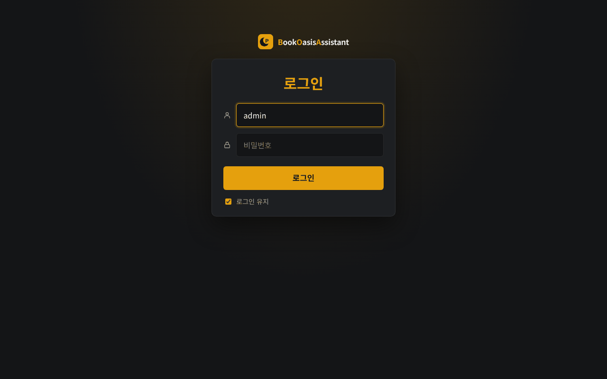

사용자가 하나도 없고 `127.0.0.1`로 열었을 때는 **관리자 계정 만들기** 화면이 먼저 나옵니다.

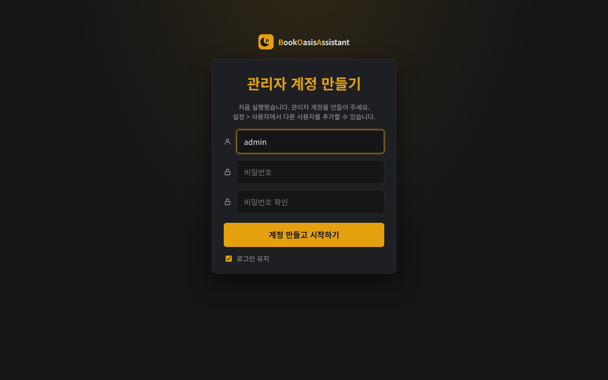

---

## 2. 웹툰 다운로더

> ⚠️ 저작권법 제30조(사적 이용을 위한 복제) 범위 안에서 개인 소장 목적으로만 쓰세요. 유료 회차를 결제하는 일은 하지 않습니다.

흐름: ① 목록 수집(스캔) → ② 구독 → ③ 새 회차 다운로드(자동 실행 또는 카드의 [다운로드]) → ④ 부가 파일(ComicInfo.xml·series.json·kavita.yaml).

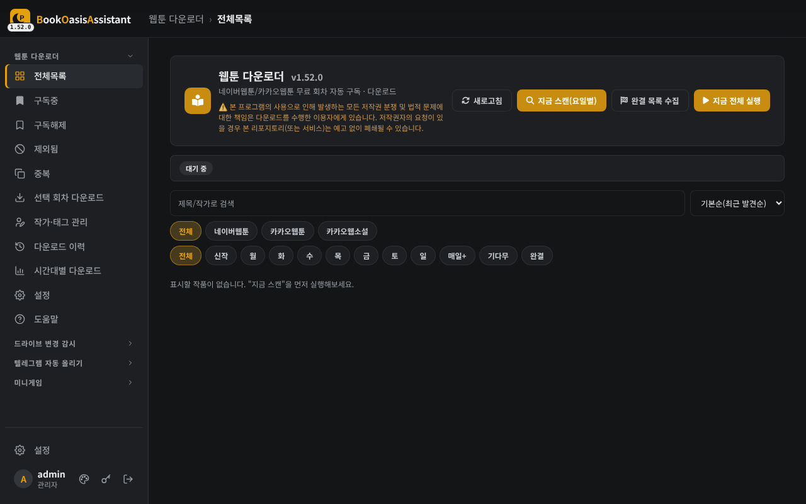

모든 설정은 **웹툰 다운로더 > 설정**에서 **[공통] [네이버웹툰] [카카오웹툰] [카카오웹소설]** 탭으로 나눠 바꾸고, 맨 위 **[설정 저장]** 한 번으로 모두 저장합니다.

### 2-1. [공통] — 자동 실행·다운로드 방식

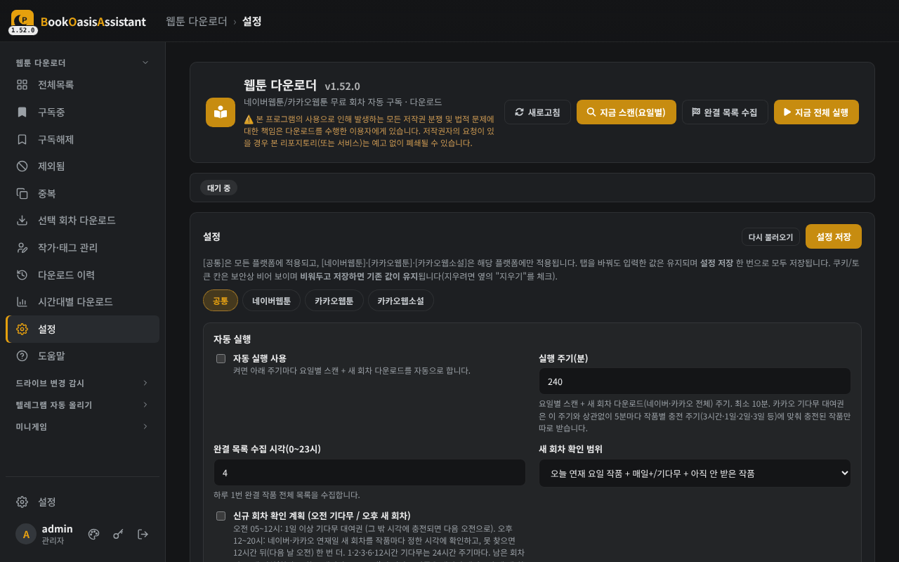

| 항목 | 넣을 것 |
|---|---|
| **자동 실행 사용** | 켜기. 이게 꺼져 있으면 버튼을 누를 때만 받습니다 |
| 실행 주기(분) | 기본 240분 (최소 10분). 카카오 기다무 대여권은 이와 별도로 충전될 때마다 받음 |
| 완결 목록 수집 시각 | 하루 한 번 완결작 목록 (기본 4시) |
| 새 회차 확인 범위 | 기본: 오늘 연재 요일 작품 + 매일+/기다무 + 아직 안 받은 작품 |

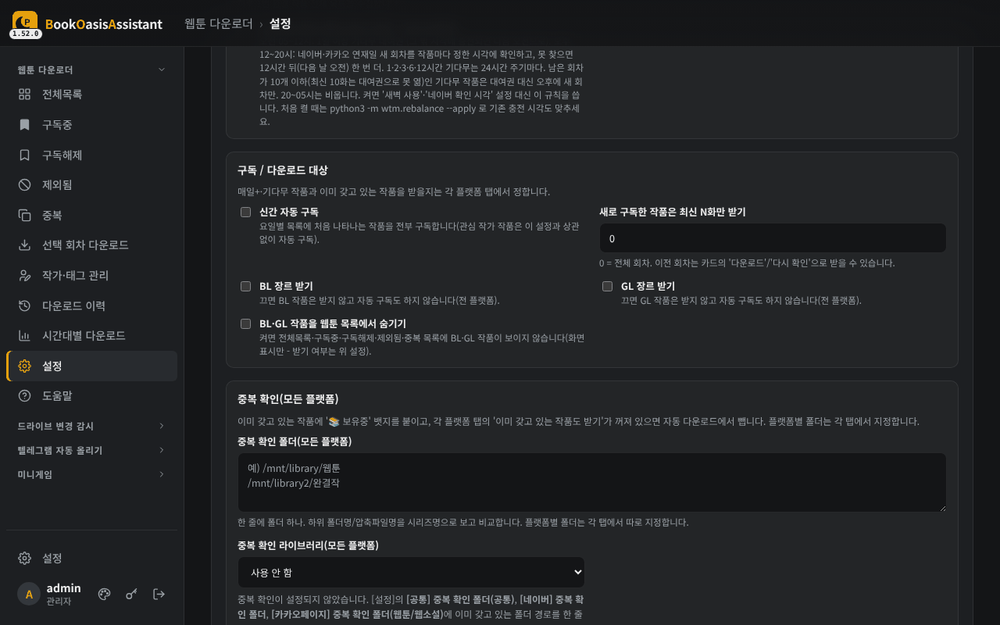

- **신간 자동 구독**: 요일 목록에 처음 나오는 작품을 모두 구독 (기본 끔 - 직접 고르려면 끈 채로).
- **새로 구독한 작품은 최신 N화만**: 0이면 전체 회차.
- **BL·GL 받기 / 목록에서 숨기기**.
- **중복 확인 폴더**: 이미 갖고 있는 웹툰 폴더를 한 줄에 하나 (예: `/mnt/library/웹툰`). 이미 있는 작품은 "📚 보유중"으로 표시되고 기본으로 받지 않습니다.

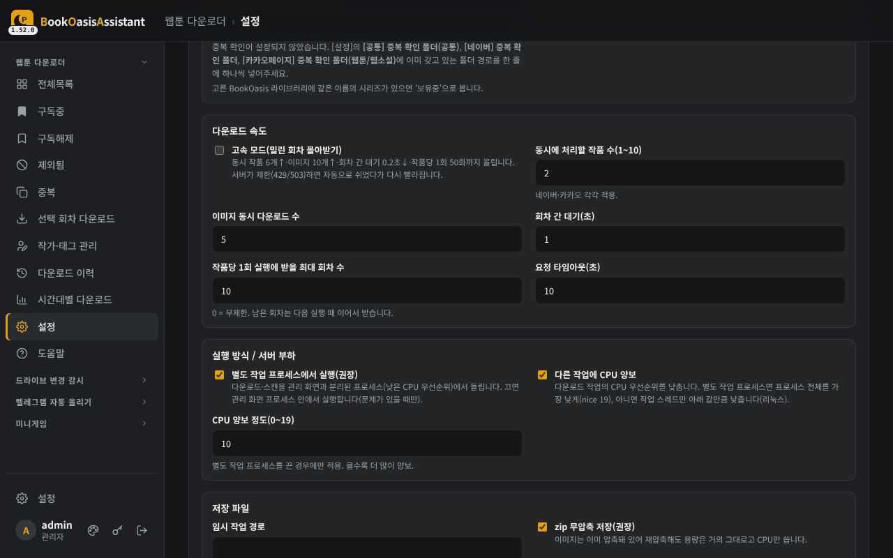

- **다운로드 속도**: 기본값 그대로 두기를 권합니다. 밀린 회차를 한꺼번에 받을 때만 **고속 모드**.
- **별도 작업 프로세스에서 실행(권장)** · **다른 작업에 CPU 양보**: 켜 둔 채로.
- **임시 작업 경로**: 저장 경로가 rclone·NAS 마운트면 **빠른 로컬 디스크** 폴더를 넣으세요 (낱장 이미지를 받아 압축하는 곳).
- 아래로 더 내리면 ComicInfo.xml / series.json / kavita.yaml 켜기, **알림**(디스코드·텔레그램·슬랙·ntfy - [알림 테스트 보내기]로 확인).

### 2-2. [네이버웹툰] — 저장 경로와 쿠키

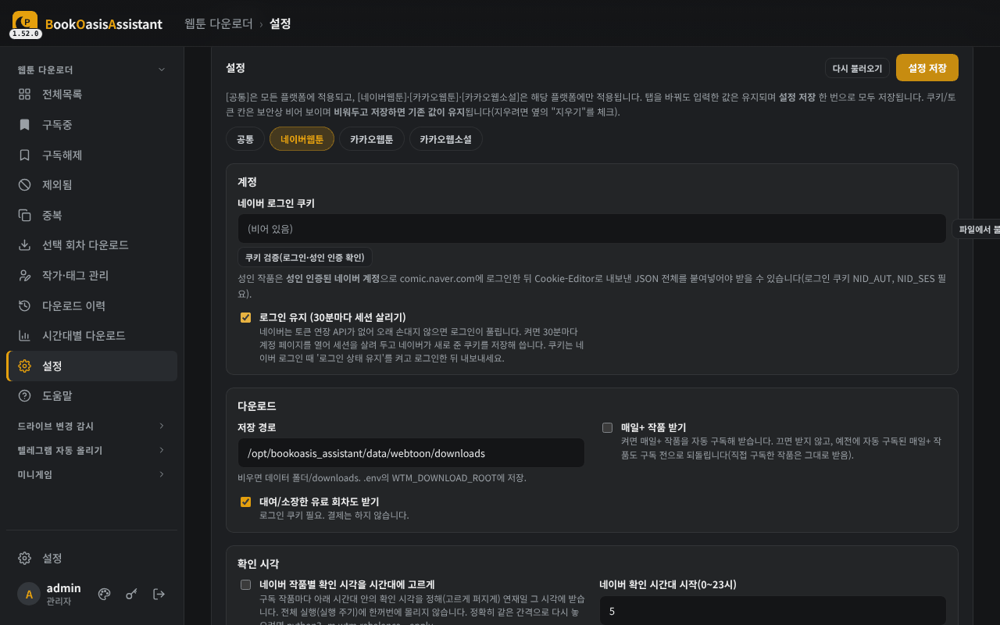

1. **저장 경로**: BookOasis 보관함 안의 폴더 (예: `/mnt/gds2/webtoon/naver`). 비우면 데이터 폴더 아래.
2. **네이버 로그인 쿠키** (성인 작품·대여/소장 회차를 받을 때만 필요):
   1. 크롬 웹스토어에서 **Cookie-Editor** 확장 설치
   2. 크롬으로 `comic.naver.com`에 로그인 (성인 작품을 받으려면 성인 인증까지)
   3. 그 페이지에서 Cookie-Editor 아이콘 → **Export** → **Export as JSON** (클립보드에 복사됨)
   4. 쿠키 칸에 붙여 넣기 (또는 [파일에서 불러오기]) → **[쿠키 검증]**으로 확인 → **[설정 저장]**
3. **로그인 유지**: 켜 두면 30분마다 세션을 갱신해 쿠키가 덜 만료됩니다.
4. 매일+ 작품 받기, 대여/소장 유료 회차 받기, 이미 갖고 있는 작품도 받기 - 필요하면 켜기.

### 2-3. [카카오웹툰] / [카카오웹소설]

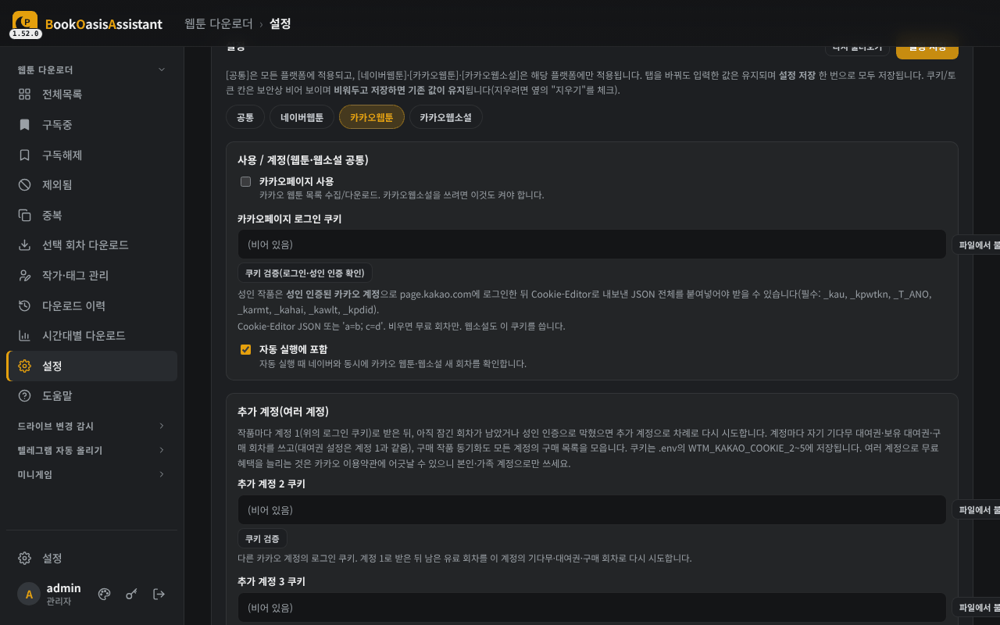

1. **카카오페이지 사용**을 켭니다 (웹소설은 [카카오웹소설]에서 따로).
2. **카카오페이지 로그인 쿠키**: 무료 회차만 받을 거면 없어도 됩니다. 성인 작품·대여권·대여/소장 회차는 필요합니다.
   `page.kakao.com`에 로그인한 뒤 네이버와 같은 방법(Cookie-Editor → Export as JSON)으로 넣고 [쿠키 검증].
3. **추가 계정 2~5**: 다른 카카오 계정 쿠키 (계정 1로 못 연 회차를 차례로 시도). 본인·가족 계정만 쓰세요.

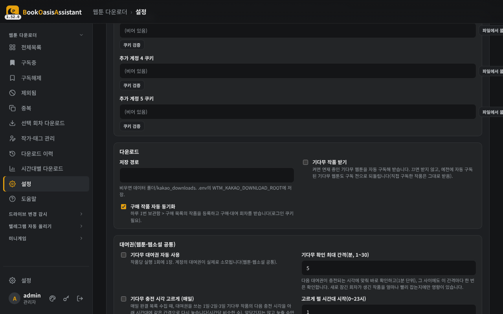

4. **저장 경로**: 예 `/mnt/gds2/webtoon/kakao` (웹소설은 `/mnt/gds2/novel/kakao`).
5. **기다무 작품 받기**, **기다무 대여권 자동 사용**, **구매 작품 자동 동기화** - 필요하면 켜기.
6. [설정 저장] 후 화면 맨 위 **[지금 스캔(요일별)]**을 한 번 눌러 목록을 채웁니다.

### 2-4. 작품 고르기와 확인

- **전체목록**에서 작품 카드의 구독 버튼 → **구독중**에 들어갑니다. 바로 받으려면 카드의 [다운로드].
- **다운로드 이력**: 언제 어떤 회차를 어떤 방법(무료·기다무·대여권)으로 받았는지, 최근 7일 받은 양.

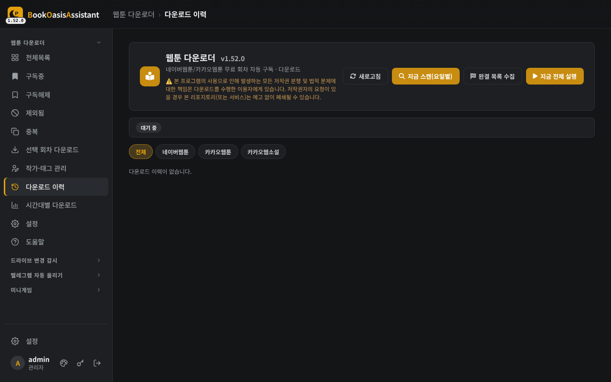

- **도움말** 탭에 처음 설정하기·쿠키 등록·각 기능 설명이 모두 있습니다.

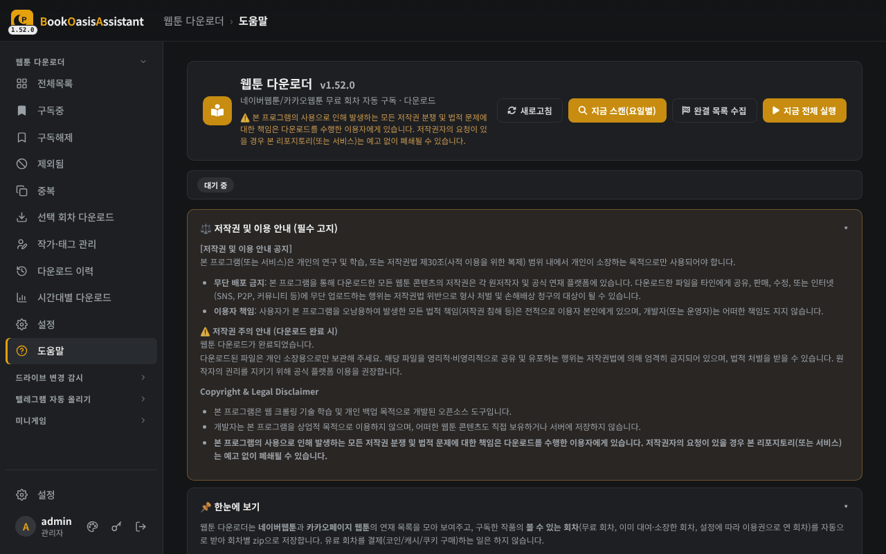

받은 회차는 저장 경로에 들어가는 즉시 드라이브 변경 감시로 넘겨져 BookOasis에 바로 스캔됩니다 (`WTM_HANDOFF_GDW`, 기본 켬).

---

## 3. 드라이브 변경 감시

Google Drive(또는 로컬 폴더)의 변경을 감지해 **rclone VFS를 새로고침**하고, **바뀐 폴더만 BookOasis에 부분 스캔**을 요청합니다.
(리눅스 전용. `.env`의 `GDW_ENABLED=true`)

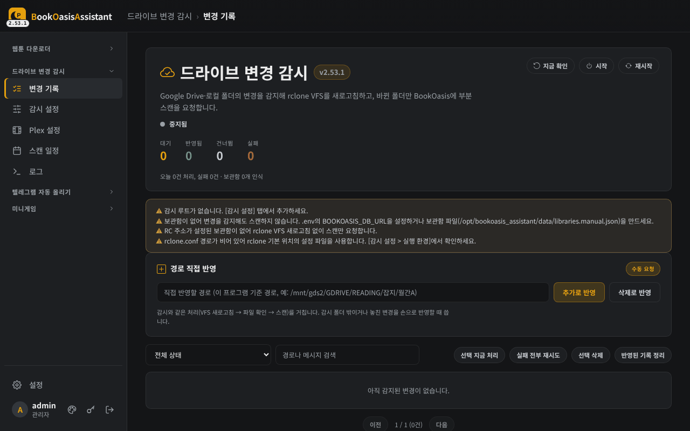

위쪽 노란 상자는 아직 설정이 덜 된 곳을 알려 줍니다. 위에서부터 하나씩 없애면 됩니다.

### 3-1. 실행 환경

**감시 설정** 탭의 **실행 환경**:

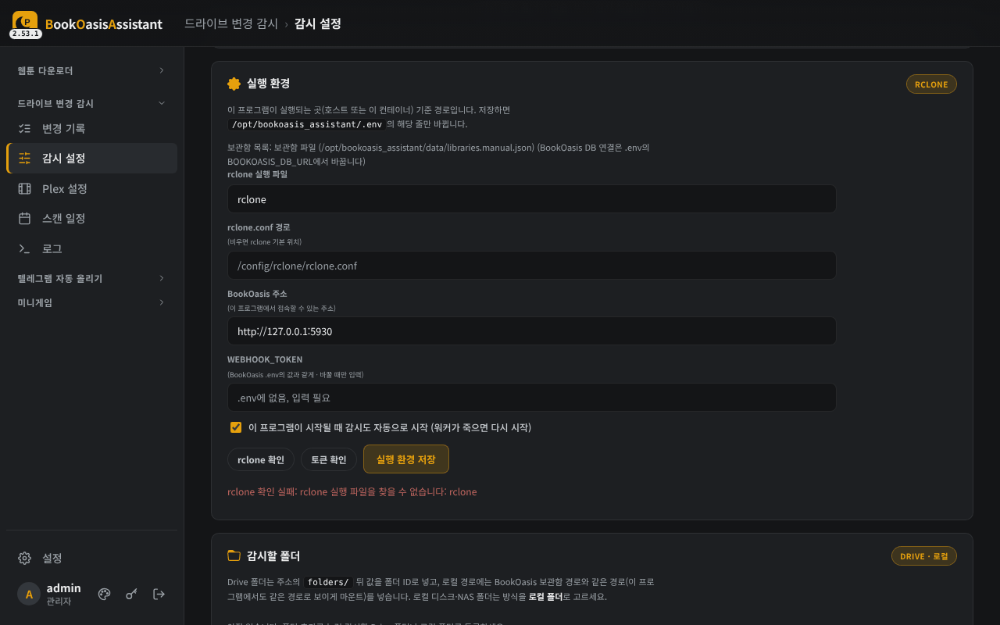

| 칸 | 넣을 것 |
|---|---|
| rclone 실행 파일 | 보통 `rclone` (다른 곳이면 전체 경로) |
| rclone.conf 경로 | BookOasis가 쓰는 rclone.conf (예: `/root/.config/rclone/rclone.conf`). 비우면 rclone 기본 위치 |
| BookOasis 주소 | 이 프로그램에서 닿는 BookOasis (예: `http://127.0.0.1:5930`) |
| WEBHOOK_TOKEN | BookOasis `.env`의 `WEBHOOK_TOKEN`과 같은 값 |
| 자동으로 시작 | 켜 두기 (워커가 죽으면 다시 시작) |

[rclone 확인] · [토큰 확인]으로 점검하고 **[실행 환경 저장]** (`.env`에 저장됨).

### 3-2. 감시할 폴더

**[+ 폴더 추가]**:

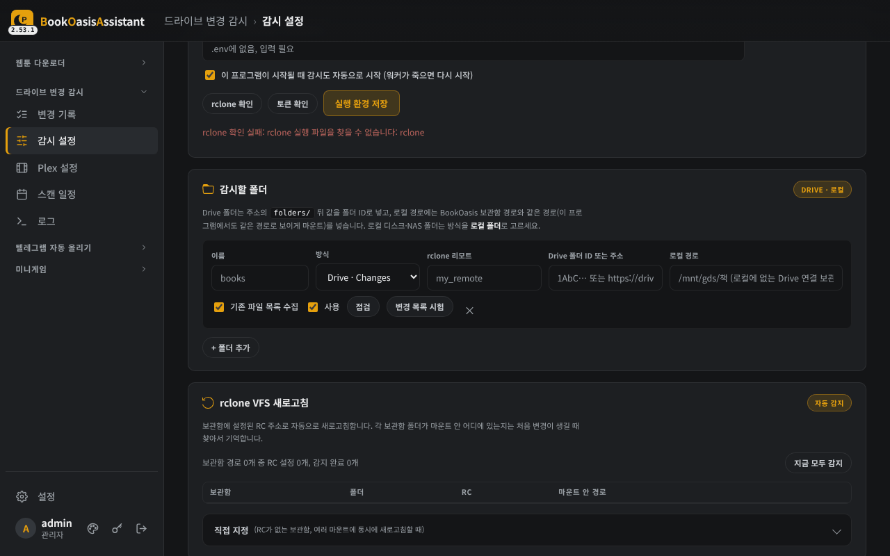

| 칸 | 넣을 것 |
|---|---|
| 이름 | 알아보기 쉬운 이름 (예: `books`) |
| 방식 | **Drive · Changes**(기본, 권장) / Drive · Activity / Drive · 폴더 비교 / **로컬 폴더**(로컬 디스크·NAS) |
| rclone 리모트 | rclone.conf의 리모트 이름 (예: `gds`) |
| Drive 폴더 ID 또는 주소 | Drive에서 그 폴더를 연 주소(`https://drive.google.com/drive/folders/1AbC…`)를 그대로 붙여 넣어도 됨 |
| 로컬 경로 | 그 폴더가 이 서버에 마운트된 경로 = **BookOasis 보관함 경로와 같은 경로** (예: `/mnt/gds/책`) |

[점검] · [변경 목록 시험]으로 확인 → 저장 → 위쪽 **[시작]**.

### 3-3. rclone VFS 새로고침 · 처리 옵션

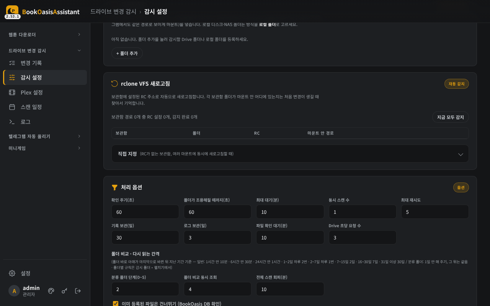

- **rclone VFS 새로고침**: BookOasis 보관함에 rclone RC 주소가 있으면 자동입니다. RC가 없는 보관함이나 여러 마운트에 동시에 보내야 하면 **직접 지정**.
- **처리 옵션**: 기본값으로 시작하세요. 확인 주기 60초, 폴더가 조용해질 때까지 60초 기다렸다 스캔, **이미 등록된 파일은 건너뛰기**(BookOasis DB 확인).

### 3-4. Plex 설정 (선택)

감시하는 폴더가 Plex 라이브러리 폴더 안이면 Plex에도 그 폴더만 스캔하라고 보냅니다.

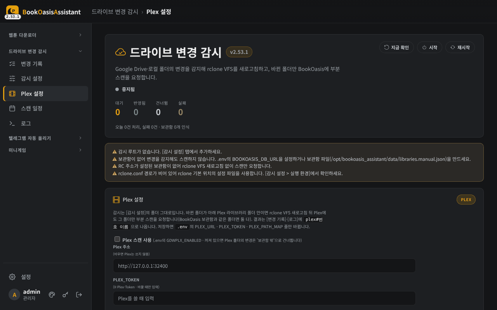

**Plex 스캔 사용**을 켜고 Plex 주소(`http://127.0.0.1:32400`), Plex 토큰, (Plex가 다른 경로로 보면) 경로 매핑 `이 프로그램 경로=Plex 경로`를 넣고 저장.
Plex 토큰은 Plex 웹에서 아무 항목 → `…` → **미디어 정보** → **XML 보기** → 주소 끝의 `X-Plex-Token=` 값입니다.
(같은 Plex 값을 텔레그램 자동 올리기의 Plex 규칙도 씁니다.)

### 3-5. 스캔 일정 · 로그

**스캔 일정**: BookOasis 보관함별 전체 스캔(cron)을 요일×시간 표로 보고, 겹치는 시간을 찾아 고칩니다 (BookOasis DB 연결 필요).

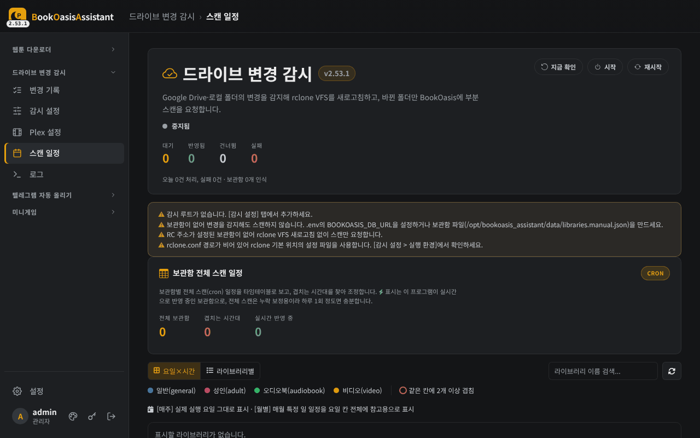

**로그**: 워커 로그 (`data/worker.log`). 문제가 생기면 여기부터 봅니다.

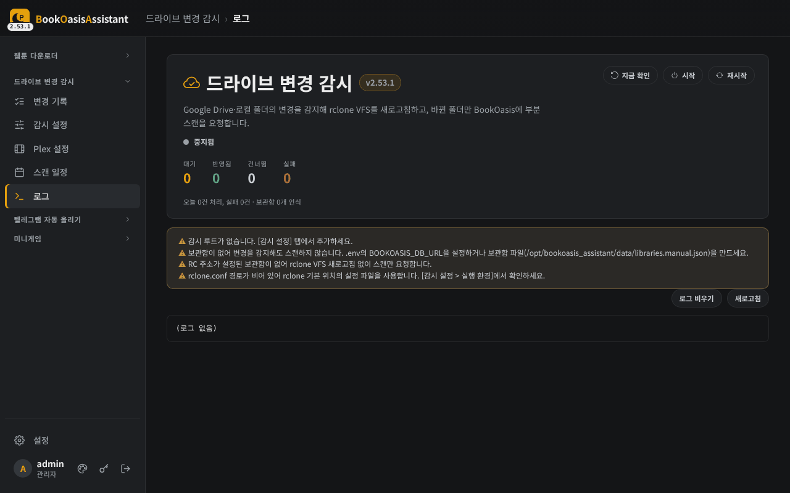

---

## 4. 텔레그램 자동 올리기

Plex 라이브러리나 rclone 드라이브 폴더에 **새로 들어온 동영상을 내 텔레그램 계정으로 채널에 자동으로** 올립니다.
텔레그램 앱에서 바로 재생되는 mp4(H.264/AAC)로 만들고, 큰 파일은 `이름_0000.mp4`, `이름_0001.mp4`…로 나눕니다.
(YMPlayer의 설정 > 자동 올리기와 같은 기능입니다. 같은 채널에 둘 다 켜면 두 번 올라가니 한쪽에서만.)

**미리 할 것**: 서버에 ffmpeg (설치 가이드 1단계), 올릴 채널에 글을 쓸 수 있는 텔레그램 계정(채널 관리자).

### 4-1. 텔레그램 계정 로그인

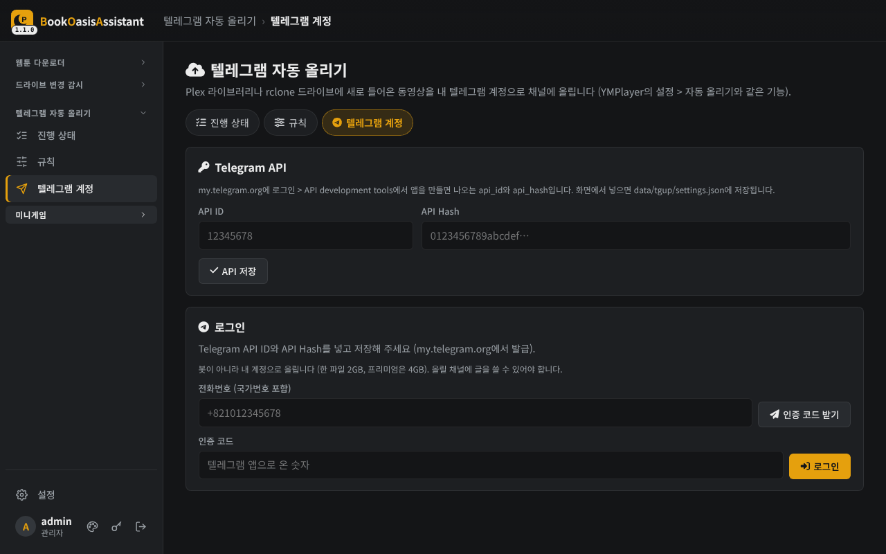

1. [my.telegram.org](https://my.telegram.org)에 전화번호로 로그인 → **API development tools** → 앱 이름 아무거나 넣고 만들기 →
   **App api_id**(숫자)와 **App api_hash**(32자리) 복사.
2. **Telegram API**에 API ID·API Hash → **[API 저장]**.
3. **로그인**: 전화번호(`+821012345678`, 국가번호 포함) → **[인증 코드 받기]** → 텔레그램 앱으로 온 숫자 → **[로그인]**
   (2단계 인증을 쓰면 비밀번호 칸이 나옵니다).
4. "✓ 이름 · 일반 계정 (2GB까지)"가 나오면 끝. 봇이 아니라 **내 계정**이라 한 파일 2GB(프리미엄 4GB)까지 올라갑니다.

### 4-2. 규칙 만들기

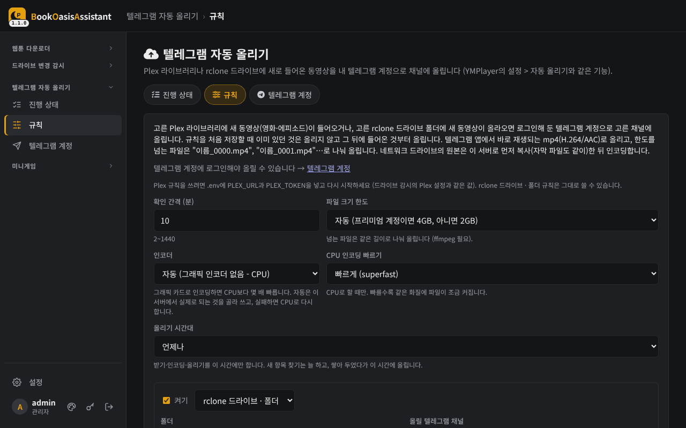

**[+ 규칙 추가]** → 

1. **종류**: **Plex 라이브러리** (`.env`에 `PLEX_URL`·`PLEX_TOKEN`이 있어야 보임) 또는 **rclone 드라이브 · 폴더**.
   - 폴더는 [고르기]로 rclone mount 폴더나 rclone 원격(`gdrive:영화`)을 고르거나 직접 적습니다. 하위 폴더까지 봅니다.
2. **올릴 텔레그램 채널**: 목록을 누르면 내 계정이 들어가 있는 채널이 나옵니다.
3. **화질**: 기본 720p (높은 영상은 줄임). 원본 그대로도 됩니다.
4. **자막이 생길 때까지 기다렸다가 올리기**(기본 12시간), **자막을 화면에 입혀 인코딩**(텔레그램 앱에서도 자막이 보임).
5. **캡션**: `{name}`(제목), `{summary}`(줄거리) 등.
6. **[저장]**. 처음 저장할 때 이미 있던 것은 올리지 않고 **그 뒤에 들어온 것부터** 올립니다.
   바로 시험하려면 규칙의 **[가장 최근 것 하나 올려 보기]**.

위쪽 공통 값: 확인 간격(기본 10분), 파일 크기 한도(자동 = 프리미엄 4GB / 일반 2GB), 인코더(그래픽 카드가 되면 자동으로 씀),
**올리기 시간대**(예: 새벽 1~7시에만).

### 4-3. 디스코드 알림

규칙 탭 맨 아래:

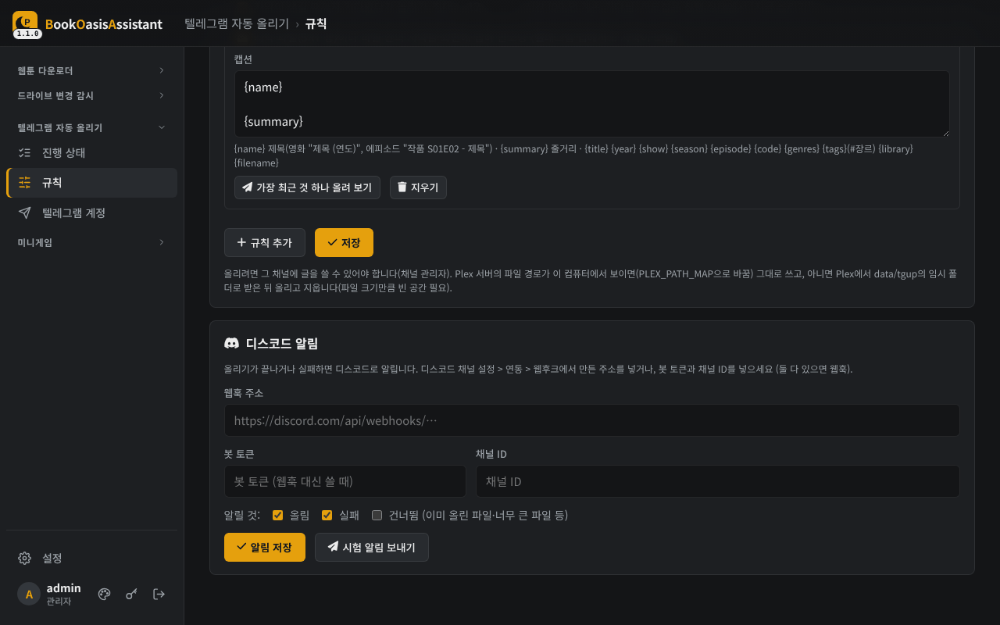

디스코드 채널 설정 → **연동** → **웹후크** → 새 웹후크 → **웹후크 URL 복사** → **웹훅 주소**에 붙여 넣기
(또는 봇 토큰 + 채널 ID). 알릴 것(올림·실패·건너뜀)을 고르고 **[시험 알림 보내기]** → **[알림 저장]**.

### 4-4. 진행 상태

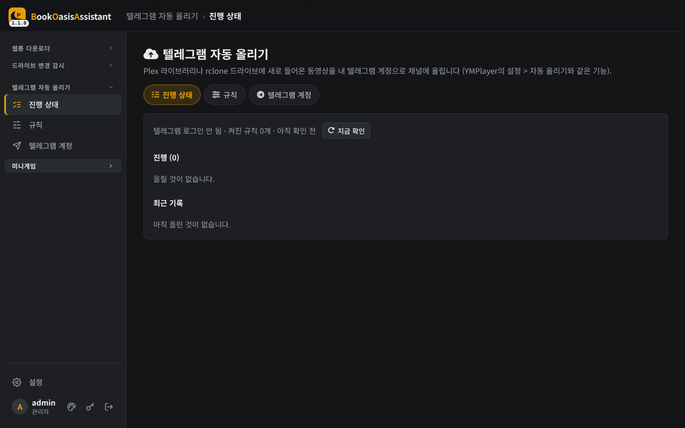

올리는 중(진행률)·올릴 차례·자막 기다림(10분 지점 장면으로 하드섭인지 보고 [지금 올리기]/[빼기])·다시 시도 대기·최근 기록.
항목마다 [취소], 여러 개면 [전체 취소]. 실패하면 10분 → 30분 → 2시간 뒤 다시(3번까지).

---

## 5. 미니게임

테트리스·지뢰찾기·오목·홀덤 등 12종. 브라우저에서만 돌아서 서버 부하가 없습니다. 최고 점수는 브라우저마다 저장됩니다.

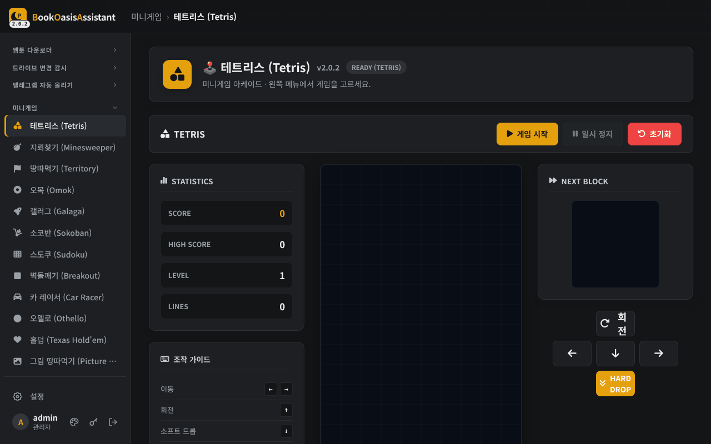

---

## 6. 전체 설정

왼쪽 맨 아래 ⚙️ **설정**을 누르면 창이 뜹니다.

| 탭 | 하는 일 |
|---|---|
| **화면** | 모든 브라우저의 기본 테마·강조색 (각자는 왼쪽 아래 🎨에서 따로) |
| **메뉴** | 왼쪽 메뉴의 모듈 순서와 모듈 안 메뉴 순서 (▲▼) |
| **사용자** | 사용자 추가·삭제·비밀번호 재설정 |
| **MCP** | Claude 같은 AI 앱 연결 토큰 ([켜기] → 연결 명령이 나옴) |
| **정보** | 모듈별 버전, GitHub 최신 버전 |

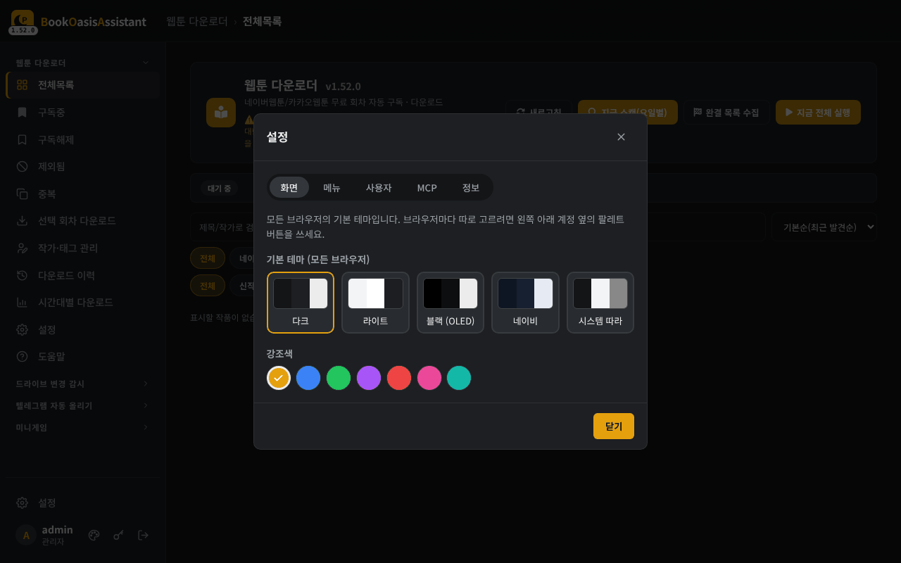
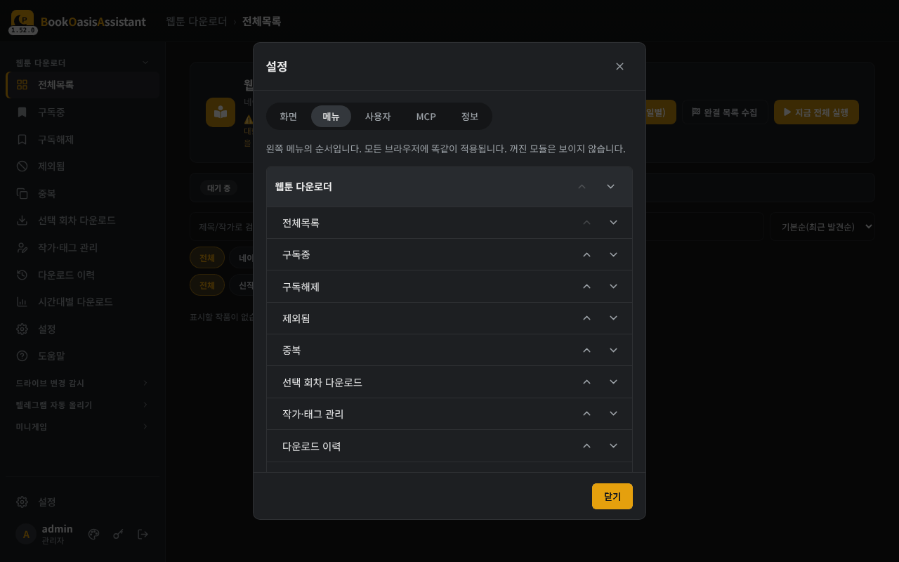
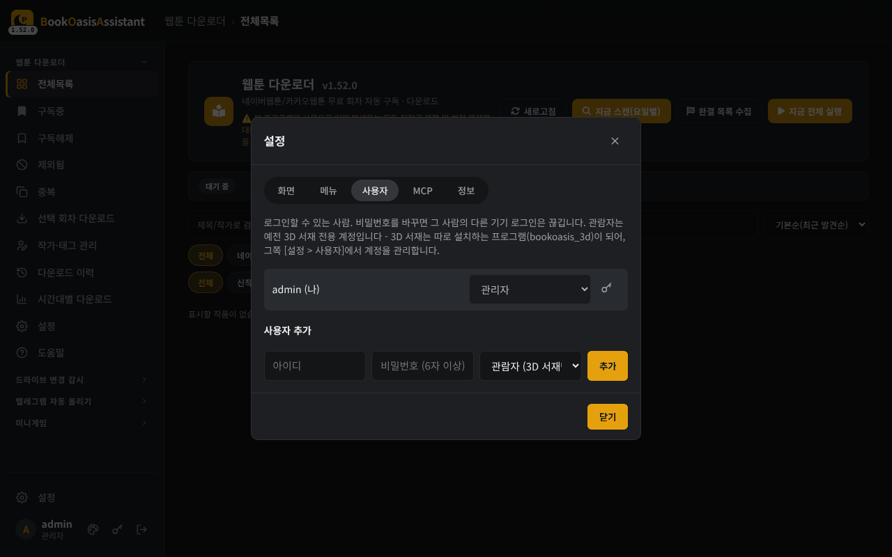
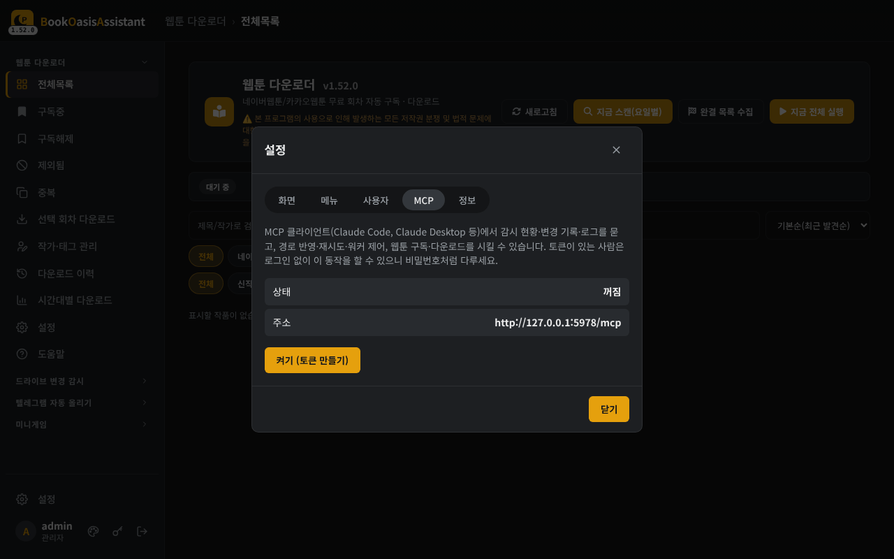
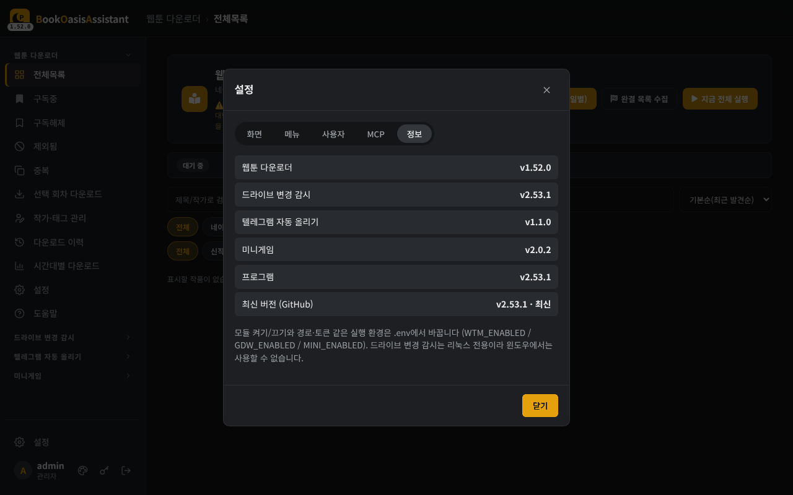

---

## 7. 휴대폰에서 쓰기

같은 주소를 휴대폰 브라우저로 열면 휴대폰 화면으로 나옵니다. 왼쪽 위 ☰로 메뉴를 엽니다.

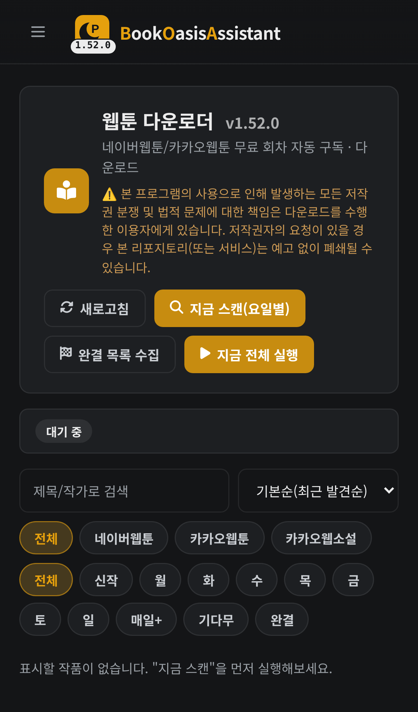

---

문제가 풀리지 않으면 `venv/bin/python app.py --check`(도커는 `docker exec bookoasis_assistant python app.py --check`) 결과와
드라이브 감시 로그 탭, 텔레그램 자동 올리기 진행 상태의 오류 문구를 같이 남겨 주세요.
